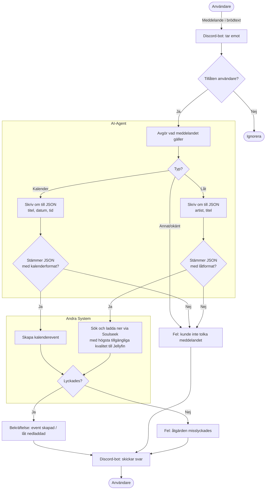

# discordBotAutomation

En egen Discord-bot som tar emot vanlig text, låter en lokal AI-modell avgöra vad meddelandet gäller och skickar arbetet vidare till rätt system. Ska köras i Docker på min egenbyggda hemmaserver

> **Status:** under utveckling, i planeringsfasen. Flödet är designat, själva bot-koden är nästa steg.

## Vad den ska göra

- Skriv ett meddelande i Discord, t.ex. *"Tandläkare på torsdag kl 14"* eller *"ladda ner [artist] - [låt]"*.
- AI-modellen avgör om det är en kalenderhändelse eller en låt och skriver om texten till strukturerad JSON.
- Boten skapar kalenderhändelsen, eller söker upp låten på Soulseek och laddar ner den i högsta tillgängliga kvalitet till Jellyfin.
- Du får en bekräftelse eller ett felmeddelande tillbaka i Discord.

## Flödet

## Designprinciper

- **AI:n tolkar, koden bestämmer.** Modellen returnerar bara data. Svaret valideras mot ett schema innan något körs, och ogiltiga svar avvisas.
- **Varje del har ett ansvar.** Discord-delen, AI-delen och de olika systemen (kalender, musik) är separerade, så att nya typer går att lägga till utan att röra resten.
- **Säkerhet från början.** Endast tillåtna användare kan styra boten, hemligheter ligger i miljövariabler och indata behandlas som otillförlitlig.
   
## Teknik

- Språk: ej valt än
- Discord: ej valt än
- AI: lokal modell, undersöker Ollama
- Kalender: Google Calendar
- Musik: Soulseek via slskd och Jellyfin
- Drift: Docker på egenbyggd hemmaserver

## Planerat

- [x] Skapa övergripande flödesschema
- [ ] Sätta upp projektstruktur, Git och `.env.example`
- [ ] Skapa Discord-bot (startar och svarar på ping)
- [ ] Begränsa åtkomst till tillåtna användare
- [ ] Välj AI-modell
- [ ] Koppla Discord-bot mot lokal AI-modell
- [ ] Skapa regler och promptar för AI (klassificering och JSON-omskrivning)
- [ ] Definiera JSON-scheman och validering för kalender och låt
- [ ] Bygg kalenderhandler
- [ ] Bygg musikhandler (Soulseek till Jellyfin)
- [ ] Felhantering och tydliga felmeddelanden i Discord
- [ ] Loggning
- [ ] Tester för JSON-valideringen
- [ ] Docker och docker-compose
- [ ] Köra på hemmaservern
      
## Framtiden

- [ ] Lägga till fler typer av meddelanden (t.ex. påminnelser)

## Vad jag lärt mig

- Hur man ritar flödesdiagram med Mermaid
- Att planera och dela upp ett projekt i steg innan jag börjar koda
